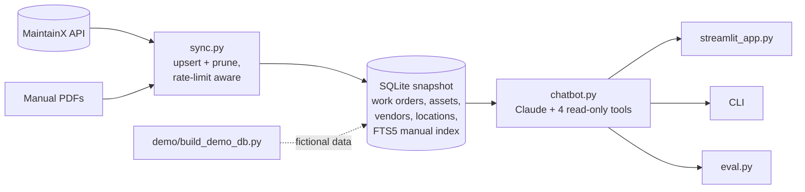

# Maintenance History Assistant

**A tool-using LLM agent that answers technicians' equipment questions in plain English, grounded in a plant's maintenance records and machine manuals, and designed above all not to make things up.**

> Built during my AI Engineer internship at Francis Cable Systems, a manufacturing company, and deployed for staff use. The production data is proprietary, so this repo runs on a **small fictional dataset** ([`demo/build_demo_db.py`](demo/build_demo_db.py)) with the same schema. Every machine, vendor, work order, and manual page in it is made up.

---

## The problem

When a machine acts up, the first question is usually "has this happened before, and what fixed it?" The answers were spread across 60+ work orders in the plant's maintenance system (MaintainX) and 600+ pages of equipment manuals. The goal was a **first line of defense** a technician or supervisor could ask before calling for help.

The risk is obvious: a confident, wrong answer about industrial equipment is worse than no answer. So the whole system is built around **only saying what the data supports**, and saying clearly when it doesn't.

## Quickstart (demo data)

```bash
pip install -r requirements.txt
cp .env.example .env              # then set ANTHROPIC_API_KEY

streamlit run streamlit_app.py    # web chat UI at http://localhost:8501
python3 chatbot.py                # or the CLI
python3 eval.py                   # run the 22-question eval suite -> eval_results.json
```

`db/demo.db` is committed, so no MaintainX account is needed. To rebuild it: `python3 demo/build_demo_db.py`.

Questions to try against the demo data:

- *When was the DeviceNet card on M1 last replaced?* (exact date, cited)
- *Which vendor worked on M1's braking resistor issue back in March?* (the record was logged in June; the real repair date is March)
- *How long does it typically take to fix a braking resistor issue?* (should refuse to invent a duration)
- *M3 is sparking near the electrical panel. What should we do?* (safety first, then history)
- *What's the maintenance history on the Large Twister?* (real machine, zero records: must not deny it exists)
- *Has the flux capacitor on M1 ever failed?* (must not play along)

## Architecture



**One data flow:** the sync writes the database, the agent reads it, and every front end (web app, CLI, eval suite) calls the same `ask()` function.

The agent gets four read-only, SQL-backed tools:

| Tool | Purpose |
|---|---|
| `list_assets` | What machines and components exist |
| `get_work_orders` | Filtered maintenance history (asset, keyword, category) |
| `search_manuals` | BM25-ranked full-text search over extracted manual pages |
| `get_reliability_stats` | Aggregate counts for "how often" questions |

For how a question moves through the system, the database schema, and the refresh design, see **[docs/ARCHITECTURE.md](docs/ARCHITECTURE.md)**.

| File | Role |
|---|---|
| [`chatbot.py`](chatbot.py) | System prompt, tool definitions and SQL, and the `ask()` agent loop |
| [`sync.py`](sync.py) | MaintainX → SQLite sync, PDF text extraction, prune logic |
| [`streamlit_app.py`](streamlit_app.py) | Chat UI, two-tier live refresh, cost display |
| [`eval.py`](eval.py) | Golden-question regression suite |
| [`db/schema.sql`](db/schema.sql) | Hand-written schema (source of truth for table shapes) |
| [`demo/build_demo_db.py`](demo/build_demo_db.py) | Builds the fictional dataset |

## Design decisions

### The system prompt is the product
Most of the anti-fabrication behavior lives in the [system prompt](chatbot.py): cite records, don't invent durations, caveat small samples, put safety first in procedural answers. Changes to it are treated as **behavior changes** and must pass the eval suite before shipping. The prompt and tool definitions form a stable prefix that is prompt-cached, so repeat calls bill it at a fraction of the cost.

### Deliberately no vector search
With about 65 work orders, embeddings would add infrastructure without adding accuracy. The agent pulls candidate records with SQL filters and lets the model judge relevance directly. The decision has a stated expiry (roughly an order of magnitude more data) rather than being an oversight.

### Tools that can't let the model overclaim
`get_work_orders` returns `{work_orders, total_matches, returned, truncated}` rather than a bare list, so the model always knows whether it is seeing everything, and the tool description tells it not to make "all/never/first" claims from a truncated set. If a response hits the token limit, the app appends an explicit "this answer was cut off" warning instead of presenting partial text as complete.

### Getting dates right
A record's `completed_at` is when someone *typed it in*, often months after the repair when an old invoice was backfilled. The sync pulls the real repair date from a custom field, and every query uses `service_date = COALESCE(actual_completion_date, completed_at)` plus a flag saying whether the date is confirmed. The prompt forbids deriving repair durations, since the data has only one date per record.

### Safe full-text search
User text is tokenized and turned into quoted literals before reaching SQLite FTS5, so words like `AND`, `NOT`, or a hyphen can't be misread as query operators.

### A sync built for a rate-limited API
The MaintainX API allows 100 requests per rolling window, and a full sync makes one detail call per record. All requests go through one function that reads the server's rate-limit headers, pauses when the budget hits zero, and waits out a 429, so large syncs slow down instead of failing. The sync is **upsert + prune**: records deleted upstream disappear locally, but a table is never pruned if its fetch came back empty, so a transient API failure can't wipe it. Manual extraction is incremental, with a three-state status so image-only PDFs aren't re-downloaded every run.

### Fresh data without redeploys
The deployed app boots from a committed snapshot, then refreshes in two tiers. A **fast tier** (work orders only) runs automatically at most every 15 minutes and has a "Refresh" button. A **full tier** (assets, locations, manuals) takes minutes and sits behind an expander, so a non-technical user isn't asked to choose. If a refresh fails, the app keeps answering from the last good data and shows a warning. (In demo mode, live refresh is disabled.)

## Evaluation

There are no unit tests in the usual sense. The regression suite is a **22-question golden set** ([`eval.py`](eval.py)) run end-to-end through the real agent, with the full transcript (tool calls and answers) saved for review. Each question guards against a specific failure mode, documented next to it:

- **Fabrication:** asking about a machine or component with no relevant history.
- **Unsafe advice:** a live electrical hazard, where safety steps must come first.
- **Fake durations:** questions that tempt the model to compute repair times it can't know.
- **Statistical overclaim:** "is M1 getting worse?" when there are only a handful of records.
- **Date confusion:** questions that only answer correctly if the real service date is used.
- **Out of scope / adversarial:** inventory and on-call data that was never synced, invented parts, pressure to "just guess".

Because some expectations depend on the dataset, each note describes the *intent* of the check so it stays meaningful after data refreshes. The demo dataset was built so every case still exercises its failure mode.

## Tech stack

Python · Anthropic API (tool use, prompt caching) · SQLite + FTS5 · Streamlit (Community Cloud) · MaintainX REST API · pypdf

## Production vs. this repo

| | Production | This repo |
|---|---|---|
| Data | ~65 real work orders, 67 assets, 650+ indexed manual pages | 20 fictional work orders, 16 assets, 12 manual pages |
| Database | Synced from MaintainX by `sync.py` | `db/demo.db` from `demo/build_demo_db.py` |
| Live refresh | Two-tier, from the MaintainX API | Disabled |

The code is the same; `chatbot.py` serves `db/mx_data.db` when it exists and falls back to `db/demo.db` otherwise (override with `MX_DB_PATH`).

## What's next

See **[docs/ROADMAP.md](docs/ROADMAP.md)**: automated eval scoring in CI, unit tests for the deterministic layer, OCR for scanned manuals, and usage logging to grow the eval set from real questions.
