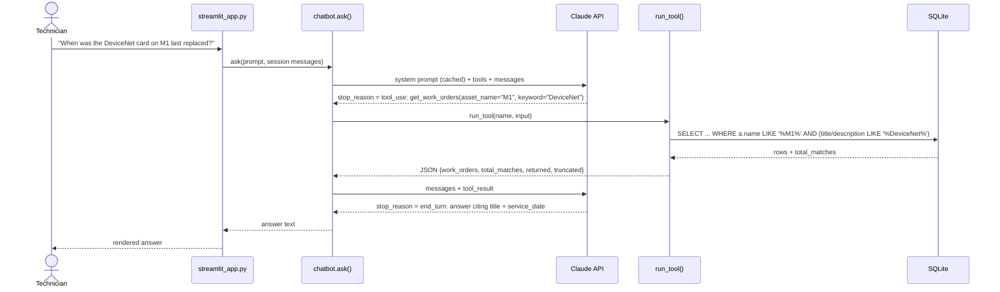
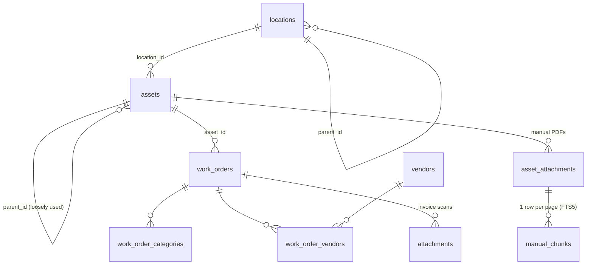
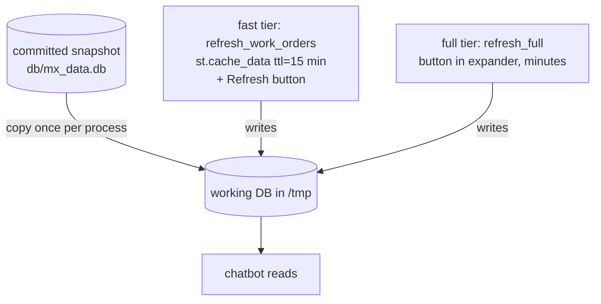

# Architecture

This walks through how the system works end to end: how a question becomes an answer, how data gets into the database, and why each piece is shaped the way it is. The [README](../README.md) has the summary.

## 1. The life of a question



`ask(user_message, messages)` in [`chatbot.py`](../chatbot.py) is a standard **tool-use loop**:

1. Append the user's message to `messages`.
2. Call the Messages API with the system prompt, the four tool schemas, and the full message history.
3. If `stop_reason == "tool_use"`, run every requested tool locally, append the results as a `tool_result` user turn, and loop.
4. Otherwise, join the text blocks and return them. If the stop reason was `max_tokens`, append a visible "this answer was cut off" warning first.

Points worth knowing:

- **The model decides which tools to call and how many times.** A single question often turns into several calls: `list_assets` to resolve "the twister line" to a real asset name, then `get_work_orders`, then `search_manuals`. The loop has no hard-coded retrieval step.
- **`messages` is mutated in place.** Streamlit keeps it in `st.session_state` so follow-up questions have context, and `eval.py` reads the tool calls back out of it afterward.
- **Tool errors don't crash the loop.** `run_tool` catches exceptions and returns `{"error": ...}` as the tool result, so the model can see the failure and adjust (for example, by retrying with a different argument).
- **Every tool is read-only SQL.** The model can't change data, which limits the damage if a work-order note or manual page contains text that tries to steer it (prompt injection).

## 2. Grounding: prompt plus tool design

The system works without fine-tuning or a retrieval pipeline because grounding is enforced in two places.

**The system prompt** ([`chatbot.py`](../chatbot.py), `SYSTEM_PROMPT`) states the rules: every factual claim must come from a tool result; cite work order title and date; never derive durations; caveat small samples; lead with safety on hazards; a machine with no history still exists.

**The tool outputs** are shaped so the model has what it needs to follow those rules:

| Rule | What the tool returns to support it |
|---|---|
| Don't claim "never" or "all" from partial data | `get_work_orders` returns `total_matches` and `truncated`, not just rows |
| Use the real repair date | `service_date` (already `COALESCE`d) plus `service_date_is_confirmed` |
| Cite manuals precisely | `search_manuals` returns `file_name` and `page_number` with each chunk |
| Don't invent stats | `get_reliability_stats` returns raw counts plus first/most-recent dates, so the model reports counts, not percentages |

The prompt and tool definitions are identical on every call, so they're sent with `cache_control` and billed at about 0.1× after the first request. Anything that varies per request (like today's date) would break that cache, so it stays out of the prompt.

### Why there's no vector search

Retrieval here is **SQL filters plus model judgment**. For "M1 keeps throwing a comm error", the model searches work orders for M1 and reads the descriptions itself to spot that "Code 7 Fault (network loss)" is the same symptom. At ~65 records the full candidate set fits easily in context, so embeddings would add an index to build, keep in sync and tune without improving answers. The tradeoff is that keyword search depends on the model trying synonyms. At roughly 10× the volume, that stops scaling and hybrid search (BM25 plus embeddings) becomes worth it.

Manual search does use ranked retrieval: SQLite **FTS5** with the **BM25** scoring function, one row per PDF page. User text is tokenized into quoted literals joined with `OR` (`_build_fts_query`), which favors recall and makes FTS operator injection impossible.

## 3. Data model



The full schema is in [`db/schema.sql`](../db/schema.sql). Details that matter:

- **Two date columns on `work_orders`.** `completed_at` is when the record was entered into MaintainX; `actual_completion_date` is the real repair date from a custom field. Queries always use the `COALESCE` of the two.
- **Categories and vendors are normalized** into join tables because a work order can have several, which keeps `GROUP BY` counts correct.
- **The asset hierarchy is loose.** In the real org, many components ("Electrical Cabinet (M1)") are separate top-level assets tied to their machine only by location and a name suffix, not `parent_id`. The prompt tells the model to treat the naming pattern as meaningful.
- **`manual_chunks` is an FTS5 virtual table.** Only `chunk_text` is indexed; the other columns are `UNINDEXED` metadata carried along for citations.

## 4. Getting data in: the sync

[`sync.py`](../sync.py) mirrors MaintainX into SQLite.

```
list work orders (paginated) ─► fetch each work order's detail ─┐
list all org assets ─► fetch each asset + its parent chain ─────┼─► upsert into SQLite ─► prune deleted ─► download & extract manual PDFs
fetch referenced vendors, all locations ────────────────────────┘
```

- **N+1 by necessity.** The list endpoints leave out fields the bot needs (categories, vendors, custom fields), so each record gets its own detail call.
- **Rate limiting in one place.** MaintainX allows 100 requests per rolling window. `api_get` reads `X-Rate-Limit-Remaining` and `X-Rate-Limit-Reset`, sleeps when the budget hits 0, and on a 429 waits out the reset and retries (up to 5 times). Nothing else in the code sleeps.
- **Upsert + prune, with a guard.** Rows are upserted with `INSERT ... ON CONFLICT DO UPDATE`, then anything no longer returned by the API is deleted, child rows first. If a fetch came back empty, the prune for that table is skipped, so an API hiccup can't wipe the database.
- **Org-wide assets.** The sync pulls every asset, not just those with work orders. Otherwise the bot would deny that machines with no history (the twister lines) exist.
- **Incremental manual extraction.** Attachment download URLs are signed and expire in about an hour, so PDFs are downloaded in the same run they're listed. `pypdf` extracts text per page. `asset_attachments.extracted` has three states: 0 = retry, 1 = indexed, 2 = parsed fine but image-only (settled, never re-downloaded). There's no OCR, so scanned drawings aren't searchable, and the prompt tells the model that.

## 5. Keeping the deployed app fresh

The production app runs on Streamlit Community Cloud, which has an ephemeral filesystem and redeploys from git.



- At boot, `st.cache_resource` copies the committed snapshot to a temp file **once per process** and repoints the chatbot's connection with `reload_db()`. The tracked file is never written at runtime.
- **Fast tier** (`sync.refresh_work_orders`): work orders, their vendors, and any newly referenced assets. It's wrapped in `st.cache_data(ttl=900)`, so however often Streamlit reruns the script, it calls the API at most once per 15 minutes. The button just clears that cache. Exceptions aren't cached, so a failed refresh retries on the next interaction.
- **Full tier** (`sync.refresh_full`): everything, including manuals. It takes minutes, so it's button-only and tucked away.
- **Concurrency.** Refresh writes and chatbot reads hit the same SQLite file through different connections. Both set `PRAGMA busy_timeout = 5000`, so a read that lands mid-commit waits instead of failing with "database is locked". The reader uses `check_same_thread=False` because Streamlit runs each rerun on a worker thread.
- **Failure mode.** If a refresh throws, the sidebar shows a warning and the bot keeps answering from the last good data.

## 6. Evaluation

[`eval.py`](../eval.py) runs 22 fixed questions through the real `ask()`, each with fresh history, and writes questions, tool calls and answers to `eval_results.json`. The questions are grouped by the failure they target: reactive fixes, history lookups, reliability/statistics, manual lookups, out-of-scope, adversarial, and vague UX. Scoring is currently a manual read of the transcript against each case's `note`. Automating that is the top item in the [roadmap](ROADMAP.md).

## 7. Cost tracking

Every API response's token usage (input, output, cache read, cache write) is added to a module-level `USAGE` dict. `usage_cost_usd()` turns it into dollars: cache reads at 0.1× the input rate, cache writes at 1.25×. The Streamlit sidebar shows the running total.
